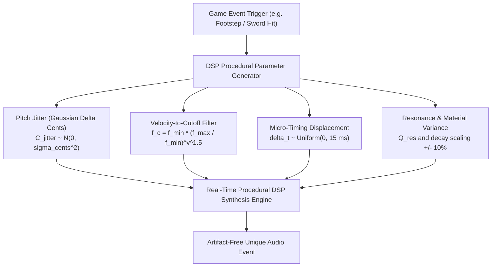
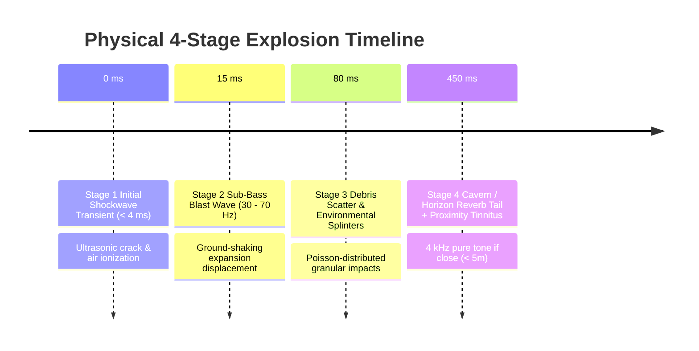
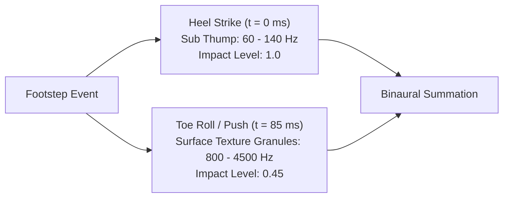

# 🔊 Interactive Game Sound Effects & Physics DSP Systems

## 📑 Table of Contents
1. [The Anti-Machine-Gun System: Micro-Jitter & Procedural Variation](#1-the-anti-machine-gun-system-micro-jitter--procedural-variation)
2. [Combat Audio Physics & Impact Acoustics](#2-combat-audio-physics--impact-acoustics)
   - [2.1 Bladed Weapons (Slashes, Clashes & Whooshes)](#21-bladed-weapons-slashes-clashes--whooshes)
   - [2.2 Blunt Weapons (Body Resonance & Heavy Impacts)](#22-blunt-weapons-body-resonance--heavy-impacts)
   - [2.3 Projectiles, Lasers & Magical Spells](#23-projectiles-lasers--magical-spells)
   - [2.4 Multi-Stage Explosion Physics & Shockwave Propagation](#24-multi-stage-explosion-physics--shockwave-propagation)
3. [Player Locomotion & Terrain Foley Physics](#3-player-locomotion--terrain-foley-physics)
   - [3.1 The Dual-Impulse Footstep Paradigm (Heel Strike & Toe Push)](#31-the-dual-impulse-footstep-paradigm-heel-strike--toe-push)
   - [3.2 Surface Material Acoustic Impedance Table](#32-surface-material-acoustic-impedance-table)
   - [3.3 Armor Clank & Clothing Friction Synthesis](#33-armor-clank--clothing-friction-synthesis)
4. [Diegetic HUD & User Interface Audio Systems](#4-diegetic-hud--user-interface-audio-systems)
   - [4.1 Interface Psychoacoustics & The Non-Fatigue Corridor](#41-interface-psychoacoustics--the-non-fatigue-corridor)
   - [4.2 Semantic Feedback Grammar: Reward vs Denial](#42-semantic-feedback-grammar-reward-vs-denial)
   - [4.3 Auditory Tunnel Vision & Critical Health Lowpass Resonators](#43-auditory-tunnel-vision--critical-health-lowpass-resonators)
5. [Audio Sprite Sheets, Voice Budgets & Priority Stealing](#5-audio-sprite-sheets-voice-budgets--priority-stealing)
6. [Production Python DSP Implementation](#6-production-python-dsp-implementation)

---

## 1. The Anti-Machine-Gun System: Micro-Jitter & Procedural Variation

When a sound effect is triggered repeatedly in rapid succession (e.g., player footsteps, assault rifle bursts, sword slashes, enemy hit reactions), playing the identical audio sample produces an immediate psychoacoustic illusion known as the **"machine-gun effect"**. The human auditory cortex detects the exact identical phase and spectral signature, instantly breaking player immersion.



### The 4 Laws of Anti-Machine-Gun Randomization
1. **Gaussian Pitch Jitter:** Pitch must not be uniform-random (which causes occasional jarring leaps). It must follow a zero-mean Gaussian distribution with standard deviation $\sigma \in [25, 55]\text{ cents}$:
   $$\Delta f = f_0 \cdot \left(2^{\frac{\Delta C}{1200}} - 1\right), \quad \Delta C \sim \mathcal{N}(0, \sigma^2)$$
2. **Velocity-Coupled Dynamic Lowpass Filtering:** Higher-velocity hits produce more high-frequency vibrational partials. Cutoff frequency $f_c$ scales exponentially with normalized impact velocity $v \in [0.1, 1.0]$:
   $$f_c(v) = f_{\min} \cdot \left(\frac{f_{\max}}{f_{\min}}\right)^{v^{1.4}}$$
3. **Micro-Attack Timing Offset:** An attack offset between $0$ and $12\text{ ms}$ breaks mechanical phase repetition across stereo channels.
4. **Round-Robin History Exclusion:** Never repeat the same variation twice in a row ($P(\text{var}_k \mid \text{var}_{k-1} = k) = 0$).

---

## 2. Combat Audio Physics & Impact Acoustics

Combat sound design requires balancing **physical realism** (transient impact mechanics) with **exaggerated psychoacoustic drama** (cinematic weight).

### 2.1 Bladed Weapons (Slashes, Clashes & Whooshes)
- **Air Whoosh (Pre-Hit):** High-velocity air displacement modeled as swept resonant bandpass noise ($Q \approx 6.0$, center frequency sweeping exponentially from $400\text{ Hz}$ to $3200\text{ Hz}$ over $120-180\text{ ms}$).
- **Blade Ringing (Metallic Clash):** When two steel blades collide, high $Q$ modal resonances ring out at harmonic partials of the steel blade ($f_1 \approx 2.4\text{ kHz}, f_2 \approx 4.8\text{ kHz}, f_3 \approx 7.1\text{ kHz}$ with decay $T_{60} \approx 400-800\text{ ms}$).
- **Flesh Impact:** Dense low-frequency impact transient ($60-120\text{ Hz}$, $35\text{ ms}$) coupled with a brief granular burst of high-frequency wet noise ($2.0-6.0\text{ kHz}$, $80\text{ ms}$).

### 2.2 Blunt Weapons (Body Resonance & Heavy Impacts)
- **Sub-Bass Thud:** A fast exponential sine drop ($120\text{ Hz} \rightarrow 35\text{ Hz}$ over $60\text{ ms}$) providing physical weight that hits the player's chest on subwoofers.
- **Wood / Bone Snap:** High-frequency, sharp transient spike ($< 3\text{ ms}$, crest factor $> 18\text{ dB}$, bandpassed at $1.8-4.2\text{ kHz}$).
- **Body Thump:** Formant-filtered noise burst centered at $280\text{ Hz}$ with $Q = 4.0$.

### 2.3 Projectiles, Lasers & Magical Spells
- **Sci-Fi Laser:** Fast downward linear or exponential FM chirp:
  $$f(t) = f_{\text{start}} \cdot e^{-k \cdot t}, \quad f_{\text{start}} = 3500\text{ Hz} \rightarrow 200\text{ Hz in } 90\text{ ms}$$
- **Magical Energy Charge:** Upward frequency sweep coupled with a $12\text{ Hz}$ amplitude-modulated sinusoidal shimmer.
- **Bullet Flyby (Whiz):** High-speed Doppler whoosh passing within centimeters of the listener's ear with instant frequency inversion.

### 2.4 Multi-Stage Explosion Physics & Shockwave Propagation
An authentic physical explosion is not a single generic "boom" sample; it is a sequence of **4 distinct acoustic stages**:



1. **Stage 1 (Initial Shockwave):** Extremely sharp, unclipped compression spike ($< 3\text{ ms}$ rise time), cutting through the entire mix.
2. **Stage 2 (Sub-Bass Expansion):** Large volume of expanding gas producing pure low-frequency energy ($30-65\text{ Hz}$) lasting $400-900\text{ ms}$.
3. **Stage 3 (Debris & Shrapnel):** Stochastic Poisson-distributed impulse cluster scattered across stereo space.
4. **Stage 4 (Proximity Tinnitus):** If the explosion occurs $< 5\text{ meters}$ from the player, the engine attenuates master audio by $-18\text{ dB}$ (temporary threshold shift) and introduces a decaying $4.0\text{ kHz}$ sinusoidal sine ring.

---

## 3. Player Locomotion & Terrain Foley Physics

Footsteps are the most frequently triggered sound in video games. They must convey character weight, armor class, movement speed, and exact terrain material.

### 3.1 The Dual-Impulse Footstep Paradigm (Heel Strike & Toe Push)
A natural human footstep is never a single thump. It consists of **two distinct physical impacts**:
1. **Impulse 1 (Heel Strike, $t = 0$):** High mechanical impact, deeper resonant thump, shorter transient. Carries $70\%$ of the downward body weight.
2. **Impulse 2 (Toe Push-off, $t \approx 70-110\text{ ms}$):** Lighter, higher-frequency scrape or gravel shift as the foot rolls forward and pushes off.



### 3.2 Surface Material Acoustic Impedance Table

| Surface Material | Heel Frequency ($f_0$) | Heel $Q$ | Surface Texture Granules | Toe Delay ($\Delta t$) | Reverb Profile |
| :--- | :--- | :--- | :--- | :--- | :--- |
| **Stone / Concrete** | $140\text{ Hz}$ | $2.5$ | High-frequency grit ($2.5 - 6.0\text{ kHz}$) | $75\text{ ms}$ | Short bright slap ($T_{60} \approx 0.3\text{s}$) |
| **Wood Floor (Hollow)** | $90\text{ Hz}$ | $5.5$ | Hollow wood cavity resonance ($320\text{ Hz}$) | $80\text{ ms}$ | Warm interior room ($T_{60} \approx 0.7\text{s}$) |
| **Dirt / Soil** | $75\text{ Hz}$ | $1.8$ | Damped granular crumble ($600 - 2200\text{ Hz}$) | $95\text{ ms}$ | Dead outdoor reflection ($T_{60} \approx 0.1\text{s}$) |
| **Gravel / Scree** | $110\text{ Hz}$ | $2.0$ | Clustered micro-impacts ($1.2 - 5.5\text{ kHz}$) | $110\text{ ms}$ | Diffuse outdoor scatter |
| **Shallow Water** | $60\text{ Hz}$ | $3.0$ | Liquid splash droplets ($800 - 4000\text{ Hz}$) | $90\text{ ms}$ | Dampened wash |
| **Metal Grating** | $220\text{ Hz}$ | $8.0$ | High metallic ringing ($3.8\text{ kHz}, 7.2\text{ kHz}$) | $65\text{ ms}$ | Industrial metallic echo |

### 3.3 Armor Clank & Clothing Friction Synthesis
Tied directly to movement speed ($v$):
- **Cloth Rustle:** Band-limited pink noise ($400 - 2800\text{ Hz}$) amplitude-modulated by a half-sine envelope on every footstep.
- **Chainmail / Plate Armor:** Metallic jitter bursts ($Q \approx 12.0$ at $3.2\text{ kHz}$ and $5.8\text{ kHz}$) delayed by $25-40\text{ ms}$ after the heel strike, simulating loose armor settling under gravity.

---

## 4. Diegetic HUD & User Interface Audio Systems

Interface audio must communicate status instantaneously without ever annoying the player over hundreds of hours of gameplay.

### 4.1 Interface Psychoacoustics & The Non-Fatigue Corridor
- **The Fatigue Zone:** Harsh frequencies between $2.8\text{ kHz}$ and $4.5\text{ kHz}$ (the human ear canal resonance) cause rapid acoustic fatigue if triggered repeatedly. UI clicks must avoid this peak unless signaling a catastrophic error.
- **The Non-Fatigue Corridor:** Warm, wooden, or glass-like tones centered in the **$800\text{ Hz} - 2.2\text{ kHz}$** band with rapid decay ($< 60\text{ ms}$) can be triggered thousands of times without cognitive fatigue.

### 4.2 Semantic Feedback Grammar: Reward vs Denial
- **Positive Confirmation (Reward):** Ascending harmonic interval (Major 3rd, Perfect 5th, or Major 6th, e.g. $\text{C}_5 \rightarrow \text{G}_5$), bright harmonic sparkle, instant attack ($< 1\text{ ms}$).
- **Negative Rejection (Denial / Error):** Descending minor interval (Minor 2nd or Tritone, e.g. $\text{F}_4 \rightarrow \text{E}_4$), damped low-pass square wave buzz, slightly sluggish attack ($10\text{ ms}$).
- **Inventory Item Move:** Organic foley texture (leather pouch, crystal glass, parchment rustle) scaled to item weight.

### 4.3 Auditory Tunnel Vision & Critical Health Lowpass Resonators
When player health drops below $20\%$:
1. The game audio engine routes master audio through a **resonant 24 dB/octave lowpass filter** sweeping down to $350\text{ Hz}$ ($Q = 2.5$).
2. Background music and ambient environment are attenuated by $-12\text{ dB}$.
3. A pulsing, binaural **heartbeat synthesis engine** takes priority:
   - Thump 1 (Lub): $55\text{ Hz}$ sine drop, gain $1.0$.
   - Thump 2 (Dub): $45\text{ Hz}$ sine drop, gain $0.7$, delayed by $180\text{ ms}$.
   - Pulse rate increases dynamically as health approaches zero.

---

## 5. Audio Sprite Sheets, Voice Budgets & Priority Stealing

To guarantee optimal real-time performance on mobile, console, or web targets:
- **Voice Allocation & Stealing Priority:**
  - Priority 1 (Uninterruptible): Player character dialogue, critical UI warnings, fatal damage impacts.
  - Priority 2: Player combat weapons, footsteps, immediate enemy attacks.
  - Priority 3: Distant environmental foley, ambient bird chirps, background particle effects.
  - When the hardware voice budget ($N_{\max} = 32\text{ or } 64$ voices) is exceeded, the oldest Priority 3 voice is stolen using a rapid $5\text{ ms}$ linear fade-out to prevent clicks.
- **Audio Sprite Sheets:** Combining multiple related variations into a single contiguous WAV file, indexed by sub-sample cue markers in JSON.

---

## 6. Production Python DSP Implementation

The following production code implements the **Anti-Machine-Gun Procedural Variation Engine** and **Dual-Impulse Footstep Synthesizer**:

```python
import numpy as np
import scipy.signal as signal
import soundfile as sf

def apply_anti_machine_gun_jitter(audio, velocity=1.0, sigma_cents=45.0, sr=44100, rng=None):
    """Applies non-repeating psychoacoustic variation: Gaussian pitch jitter,
    velocity-dependent dynamic lowpass filtering, and micro-timing displacement.
    """
    rng = rng or np.random.default_rng()
    x = np.asarray(audio, dtype=np.float32)
    
    # 1. Gaussian Pitch Jitter
    cents_jitter = rng.normal(0.0, sigma_cents)
    semitones = cents_jitter / 100.0
    pitch_ratio = 2.0 ** (semitones / 12.0)
    
    # Resample using polyphase filtering for artifact-free pitch shift
    new_len = int(round(len(x) / pitch_ratio))
    if new_len > 10 and abs(pitch_ratio - 1.0) > 1e-4:
        shifted = signal.resample(x, new_len)
    else:
        shifted = x.copy()
        
    # 2. Velocity-Coupled Dynamic Lowpass Filter
    vel = float(np.clip(velocity, 0.1, 1.0))
    fc = 1200.0 * ((18000.0 / 1200.0) ** (vel ** 1.4))
    fc = min(sr * 0.45, max(400.0, fc))
    sos = signal.butter(2, fc, btype='lowpass', fs=sr, output='sos')
    filtered = signal.sosfilt(sos, shifted)
    
    # 3. Micro-Timing Displacement (0 to 8 ms)
    displacement_samps = int(rng.uniform(0.0, 0.008) * sr)
    if displacement_samps > 0:
        out = np.zeros(len(filtered) + displacement_samps, dtype=np.float32)
        out[displacement_samps:] = filtered
    else:
        out = filtered
        
    return out.astype(np.float32)


def synth_dual_impulse_footstep(surface='stone', velocity=1.0, sr=44100, seed=None):
    """Synthesizes an authentic dual-impulse footstep (heel strike + toe push-off)
    with physical surface material acoustic impedance.
    """
    rng = np.random.default_rng(seed)
    surfaces = {
        'stone': {'f0': 140.0, 'q': 2.5, 'tex_band': [2500, 6000], 'toe_ms': 75.0, 'dur': 0.25},
        'wood':  {'f0': 90.0,  'q': 5.5, 'tex_band': [300, 1800],   'toe_ms': 80.0, 'dur': 0.35},
        'dirt':  {'f0': 75.0,  'q': 1.8, 'tex_band': [600, 2200],   'toe_ms': 95.0, 'dur': 0.28},
        'gravel':{'f0': 110.0, 'q': 2.0, 'tex_band': [1200, 5500],  'toe_ms': 105.0,'dur': 0.32},
    }
    cfg = surfaces.get(surface, surfaces['stone'])
    n = int(cfg['dur'] * sr)
    t = np.arange(n) / sr
    out = np.zeros(n, dtype=np.float32)
    
    # 1. Heel Strike (t = 0 ms): Low damped resonant thump
    heel_env = np.exp(-t * (cfg['q'] * 12.0))
    heel_thud = np.sin(2 * np.pi * cfg['f0'] * t) * heel_env
    out += heel_thud * 0.8 * velocity
    
    # 2. Toe Roll / Push-Off (t = toe_ms): Granular surface scatter
    toe_start = int((cfg['toe_ms'] / 1000.0) * sr)
    if toe_start < n:
        toe_len = n - toe_start
        toe_t = np.arange(toe_len) / sr
        noise = rng.standard_normal(toe_len).astype(np.float32)
        sos_tex = signal.butter(2, [cfg['tex_band'][0], cfg['tex_band'][1]], btype='bandpass', fs=sr, output='sos')
        filtered_tex = signal.sosfilt(sos_tex, noise)
        toe_env = np.exp(-toe_t * 35.0)
        out[toe_start:] += filtered_tex * toe_env * 0.45 * velocity
        
    return out.astype(np.float32)
```
